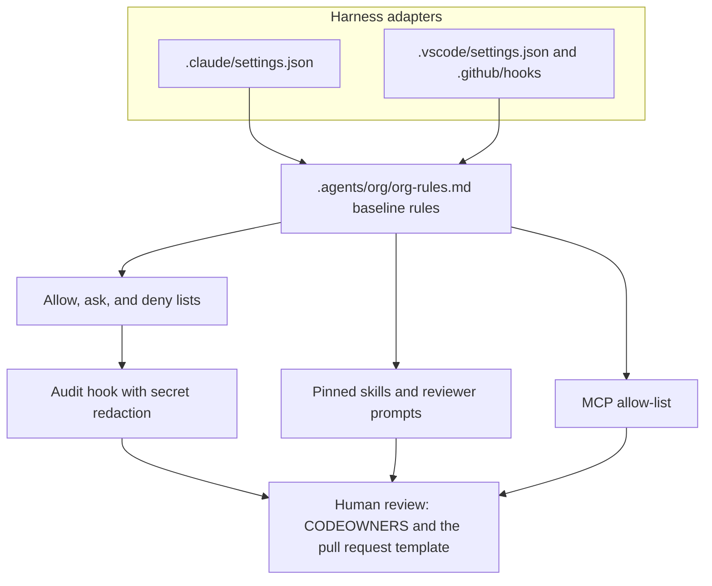

# Agentic SDLC guardrails

Coding agents will edit the repository they are pointed at, including the files that were supposed to limit them. This template is a small, vendor-neutral set of rules, permission lists, an audit hook, reviewed-skill prompts, and blank SDLC forms so Claude Code and GitHub Copilot start from the same limits.

It is a GitHub template repository, not an application. [TicketDesk](examples/ticketdesk/) is a labelled example of the documents filled in for a fictional help desk. There is no service to run.

## The problem

An agent session can:

- run a destructive git or cloud command because the prompt said to
- follow instructions that were hidden in a file, a web page, or a tool description
- call an MCP server nobody reviewed
- write a secret into a log that later gets committed

A system prompt that says "be careful" does not stop any of those. The limits have to live in files the harness actually enforces, and a human has to remain the one who merges.

## Guardrail layers



| Layer | Where | What it does |
|---|---|---|
| Baseline rules | [`.agents/org/org-rules.md`](.agents/org/org-rules.md) | What an agent must not do, in every mode. Project files do not override this. |
| Harness permissions | [`.claude/settings.json`](.claude/settings.json), [`.vscode/settings.json`](.vscode/settings.json) | Allow, ask, and deny for shell, reads, and edits. Cloud CLIs, force-push, and edits to the guardrail files are denied. |
| Audit hook | [`.agents/hooks/audit_log.py`](.agents/hooks/audit_log.py) | Appends each tool call to `.agents/audit/audit.jsonl`. Secrets are redacted by key name and by value shape. |
| Skills | [`.agents/skills/`](.agents/skills/) | `grill`, `spec-draft`, `acceptance-tdd`, `migration-writer`, `test-generator`. Claude Code reads the mirror in `.claude/skills/`. |
| Reviewers | [`.github/agents/`](.github/agents/) | Read-only code and security review prompts. They do not approve. |
| MCP allow-list | [`.agents/mcp-allowlist.yml`](.agents/mcp-allowlist.yml) | No server is enabled until you copy a reviewed entry in. |
| Human gates | [`CODEOWNERS`](CODEOWNERS), [pull request template](.github/pull_request_template.md) | Guardrail edits name an owner. The template records who prompted the agent. |
| Forms | [`docs/templates/`](docs/templates/) | Constitution, threat model, spec, design, tasks, ADR, and the release and incident forms. |

## Quick start

You need Python 3, git, and either Claude Code or GitHub Copilot in VS Code.

```sh
sh scripts/doctor.sh
python3 -m unittest discover -s tests -v
```

### Claude Code

1. Open this repository in Claude Code. `CLAUDE.md` pulls in `AGENTS.md` and the baseline rules.
2. `.claude/settings.json` already denies destructive commands and edits to the guardrail files.
3. The same file registers a `PreToolUse` and a `PostToolUse` hook. Both run `.agents/hooks/audit_log.py`. `python3` is tried first, then `python`.
4. Confirm the hook writes a line (the log is gitignored):

```sh
mkdir -p .agents/audit
printf '%s\n' '{"tool_name":"Bash","tool_input":{"cmd":"echo hello"}}' \
  | python3 .agents/hooks/audit_log.py pre claude
```

5. Set `AGENT_OPERATOR` to the human accountable for the session. `AGENT_MODE` defaults to `M1` (pair). Use a tasks file and an `agent/*` branch for delegated work.
6. Skills are discovered from `.claude/skills/`. If you edit `.agents/skills/`, run `sh scripts/sync-skills.sh`.

### GitHub Copilot

1. Open the repository in VS Code with Copilot chat. `AGENTS.md` and [`.github/copilot-instructions.md`](.github/copilot-instructions.md) load as instructions.
2. [`.vscode/settings.json`](.vscode/settings.json) turns off auto-approve for force-push, cloud CLIs, and merge commands.
3. [`.github/hooks/audit.json`](.github/hooks/audit.json) runs the same audit script before and after tool calls (`pre copilot` / `post copilot`).
4. Code review and security review prompts are in `.github/agents/`. Invoke them as Copilot agents; they are read-only.

## How to adapt this for your project

1. On GitHub, open **Settings → General** and mark the repository as a template. New products start with **Use this template**.
2. Replace `@YOUR_GITHUB_USER` in [`CODEOWNERS`](CODEOWNERS) with the account that must approve guardrail changes, and turn on branch protection for those paths.
3. Copy [`docs/templates/constitution.md`](docs/templates/constitution.md) to `docs/constitution.md` and fill it in. The [TicketDesk constitution](examples/ticketdesk/docs/constitution.md) is a filled example, not a default you should adopt by accident.
4. Copy the threat-model template to `docs/security/threat-model.md` and hold a real session. The [TicketDesk threat model](examples/ticketdesk/docs/security/threat-model.md) is illustrative.
5. Add MCP servers only by copying the example in `.agents/mcp-allowlist.yml` into `servers:` and replacing every `TODO`.
6. Tighten the deny lists for your own risky paths (auth modules, migrations, infrastructure).
7. Delete `examples/ticketdesk/` when you do not want the sample in your product repo.
8. Set `AGENT_OPERATOR` in the environment you use for agent sessions.

### Forms

| Template | Copy to |
|---|---|
| [constitution.md](docs/templates/constitution.md) | `docs/constitution.md` |
| [threat-model.md](docs/templates/threat-model.md) | `docs/security/threat-model.md` |
| [spec.md](docs/templates/spec.md) | `docs/specs/<id>/spec.md` |
| [design.md](docs/templates/design.md) | `docs/specs/<id>/design.md` |
| [tasks.md](docs/templates/tasks.md) | `docs/specs/<id>/tasks.md` |
| [adr.md](docs/templates/adr.md) | `docs/adr/NNNN-title.md` |
| [pull_request_template.md](docs/templates/pull_request_template.md) | already installed at `.github/pull_request_template.md` |
| [rfc.md](docs/templates/rfc.md) | `docs/rfcs/` |
| [waiver.md](docs/templates/waiver.md) | `docs/waivers/` |
| [runbook.md](docs/templates/runbook.md) | `docs/runbooks/` |
| [postmortem.md](docs/templates/postmortem.md) | `docs/postmortems/` |
| [release-checklist.md](docs/templates/release-checklist.md) | the release pull request |
| [production-readiness-review.md](docs/templates/production-readiness-review.md) | `docs/release/prr.md` |
| [handover-pack.md](docs/templates/handover-pack.md) | `docs/handover/README.md` |

## Layout

```
.agents/org/org-rules.md     baseline rules
.agents/hooks/audit_log.py   audit logger
.agents/mcp-allowlist.yml    reviewed MCP servers (empty until you add one)
.agents/skills/              canonical skills
.claude/settings.json        Claude Code permissions and hooks
.claude/skills/              mirror of .agents/skills
.github/hooks/audit.json     Copilot hook
.github/agents/              reviewer prompts
docs/templates/              blank forms
examples/ticketdesk/         fictional worked example
tests/                       redaction, hook wiring, banned-term check
```

## Licence

[MIT](LICENSE). Copyright 2026 Suresh Karri.

See [CONTRIBUTING.md](CONTRIBUTING.md) and [SECURITY.md](SECURITY.md). Before you publish a fork, scan the full git history for secrets. If anything is found, publish a new repository whose first commit is the cleaned tree.
