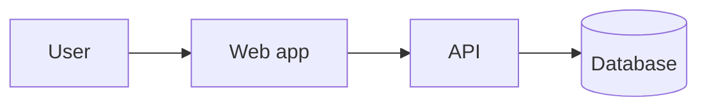

<!--
TEMPLATE: Feature design
Copy to: docs/specs/<SPEC-ID>-<slug>/design.md
Write it after the spec is approved. An agent may draft it. A human approves it.
Describe only what changes. Link to existing architecture docs instead of pasting them.
-->

# Design: SPEC-<nnn> <Feature title>

| Field | Value |
|---|---|
| Spec | ./spec.md |
| Status | Draft / Approved |
| Accountable human | <name> |
| Drafted with an agent? | <no / yes: harness and model> |
| Approver | <name> |

## 1. Summary

<!-- Three to five sentences: the approach, and why. -->

## 2. What changes in the architecture

- New external system or user type: <none / describe>
- New deployable, queue, or datastore: <none / describe>
- Modules added or changed: <by feature>

## 3. Data model and migration

| Change | Table or column | Type | Safe with the previous release? |
|---|---|---|---|
| <add column> | <orders.status_v2> | <enum> | <yes> |

| Step | Release | Action | Rollback |
|---|---|---|---|
| Expand | <vX.Y> | Add a nullable column, table, or concurrent index | Drop the new object |
| Migrate | <vX.Y> | Write both shapes; backfill in batches of <n> | Stop the backfill |
| Contract | <vX.Y+1> | Remove the old column after every reader has moved | Ship the previous release |

- Lock risk: <notes>
- Backfill size: <rows and expected minutes>

## 4. API

| Endpoint | Change | Breaking? | Who must update |
|---|---|---|---|
| <POST /api/x> | <new optional field> | <no> | <regenerate the client> |

- A breaking change needs a version bump, a deprecation window, and a date when old clients stop working.
- Errors use a documented problem-details shape.
- If you generate a client, regenerate it in this pull request.

## 5. Threat-model delta

<!-- Required for auth, personal data, payments, file upload, integrations, or any model/agent action. Otherwise say why it does not apply. -->

| Threat id | Category | Mitigation | Verified by |
|---|---|---|---|
| | | | |

## 6. Decisions

| Decision | ADR |
|---|---|
| <decision> | <ADR-NNNN, or why no ADR is needed> |

## 7. Tests

| Criterion | Layer | Test name (contains the criterion id) | Owner |
|---|---|---|---|
| SPEC-<nnn>/AC-1 | unit or API | <path>::<test name> | <role> |
| SPEC-<nnn>/AC-2 | end to end | <path> | <role> |

Also: <load, accessibility, or abuse tests, if any>

## 8. Rollout

| Item | Plan |
|---|---|
| Flag | `<flag-key>`, default off |
| Ramp | <staff only, then a percent, then everyone> |
| Kill switch | turn the flag off; effect: <...> |
| Flag removal | <date>, issue <#> |

## 9. Observability

- Spans: <names>
- Metrics: <name, type, labels>
- Logs (no personal data): <events>
- Alerts and the runbook they link to: <...>
- Model traces: <trace name, prompt id, where feedback is stored>

## 10. Risks

| Risk | Likelihood | Impact | Mitigation |
|---|---|---|---|
| | | | |

## 11. Approval

| Role | Name | Date |
|---|---|---|
| Tech lead | | |
