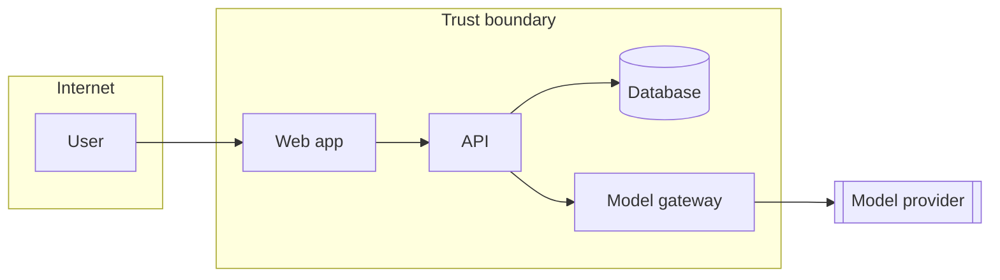

<!--
TEMPLATE: Threat model
Copy to: docs/security/threat-model.md
One living document per project. Features add rows; they do not start a second file.
Run a session when the project starts, and again for any high-risk change:
auth, personal data, payments, file upload, integrations, or a model/agent feature.
A 60–90 minute session with the tech lead, a security reviewer, and a developer is enough.
An agent may draft rows. Humans decide which ones are real.

Four questions: What are we working on? What can go wrong? What will we do about it?
Did we do a good enough job?

Ids: TM-<nnn>. Optional adversarial-ML labels can use MITRE ATLAS ids.
A filled example lives in examples/ticketdesk/docs/security/threat-model.md.
-->

# Threat model — <Project name>

| Field | Value |
|---|---|
| Version | <n> |
| Last session | <YYYY-MM-DD> |
| Participants | <names and roles> |
| Security reviewer | <name> |
| ASVS level | <L1 / L2> |

## 1. What are we working on?

### 1.1 Scope

<!-- The system or feature this session covers. -->

### 1.2 Data-flow diagram

### 1.3 Assets and trust boundaries

| Asset | Classification | Where it lives |
|---|---|---|
| <personal data> | Confidential | database; logs must be redacted; prompts must be masked |

| Boundary | Between | Controls on the crossing |
|---|---|---|
| TB-1 | Internet and API | TLS, authentication, rate limit, input validation |

## 2. What can go wrong?

| ID | Element | STRIDE | Threat | Likelihood | Impact | Mitigation | Status | Verified by |
|---|---|---|---|---|---|---|---|---|
| TM-001 | User to API | Spoofing | Stolen session reused | M | H | Short-lived tokens, rotation | Open | <test> |
| TM-002 | API to database | Tampering | Injection via a filter | L | H | Bound parameters only | Open | <SAST rule> |
| TM-003 | API | Repudiation | Admin action with no audit trail | M | M | Append-only audit log | Open | <test> |
| TM-004 | API to logs | Information disclosure | Personal data in logs | M | H | Redaction | Open | <test> |
| TM-005 | API | Denial of service | Unbounded list | M | M | Pagination and rate limits | Open | <load test> |
| TM-006 | API | Elevation of privilege | Object id from another owner | M | H | Ownership check on the server | Open | <test> |

## 3. Model threats (OWASP Top 10 for LLM Applications, 2025)

<!-- Fill every row that applies. Mark N/A with a reason when a category cannot apply. -->

| Category | Applies? | Threat here | Mitigation | Verified by |
|---|---|---|---|---|
| LLM01 Prompt injection | | | Separate instructions from data; tool allow-list; no secrets in context | |
| LLM02 Sensitive disclosure | | | Mask before the prompt; filter retrieval by permission | |
| LLM03 Supply chain | | | Pin models; review plugins | |
| LLM04 Data and model poisoning | | | Validate what you ingest; keep lineage | |
| LLM05 Improper output handling | | | Parse output into a schema; do not render or execute it raw | |
| LLM06 Excessive agency | | | Least-privilege tools; a human approves irreversible actions | |
| LLM07 System prompt leakage | | | No secrets in prompts; probe for leakage | |
| LLM08 Vector and embedding weaknesses | | | Tenant filter on retrieval; a way to delete embeddings | |
| LLM09 Misinformation | | | Ground answers; fail closed when grounding is weak | |
| LLM10 Unbounded consumption | | | Budgets, rate limits, max tokens | |

## 4. Agentic threats (OWASP Top 10 for Agentic Applications, 2026)

<!-- Fill this for any agent inside the product, and once for the coding-agent setup itself. -->

| Category | Applies? | Threat | Mitigation | Verified by |
|---|---|---|---|---|
| ASI01 Goal hijack | | | Treat untrusted text as data; restate the goal; human approval for high-impact actions | |
| ASI02 Tool misuse | | | Typed parameters and an allow-list | |
| ASI03 Identity and privilege abuse | | | Per-agent identity; short-lived scoped credentials | |
| ASI04 Supply chain (MCP, plugins, tool text) | | | Pinned, reviewed servers; rescan when descriptions change | |
| ASI05 Unexpected code execution | | | Sandbox; no host shell for a production agent | |
| ASI06 Memory poisoning | | | Provenance, expiry, and checks on what may be stored | |
| ASI07 Insecure inter-agent messages | | | Authenticated, schema-checked messages | |
| ASI08 Cascading failures | | | Step limits, circuit breakers | |
| ASI09 Trust exploitation | | | Show the exact effect before a human confirms | |
| ASI10 Rogue agents | | | Kill switch and an action audit trail | |

## 5. Privacy (LINDDUN, short form)

<!-- Use this when you process personal data. -->

| Category | Question | Finding | Mitigation |
|---|---|---|---|
| Linking | Can records be combined into a profile? | | |
| Identifying | Can a person be identified from data you call anonymous? | | |
| Non-repudiation | Are people unable to deny an action they should be able to deny? | | |
| Detecting | Can someone infer that a person is in the system? | | |
| Disclosure | Do you collect or share more than the feature needs? | | |
| Unawareness | Do people know what you collect, including model use? | | |
| Non-compliance | Do retention, consent, and deletion (including embeddings) actually happen? | | |

## 6. Actions

| Threat | Action | Owner | Issue | Due |
|---|---|---|---|---|
| | | | | |

## 7. Did we do a good enough job?

- [ ] Every trust boundary has at least one threat
- [ ] Every high-impact threat is mitigated or has a dated waiver
- [ ] Every mitigation names a test or a check
- [ ] Model and agent sections are filled for every such feature
- [ ] Notes for the next session: <...>

## Change log

| Date | Version | Change | Participants |
|---|---|---|---|
| | | | |
