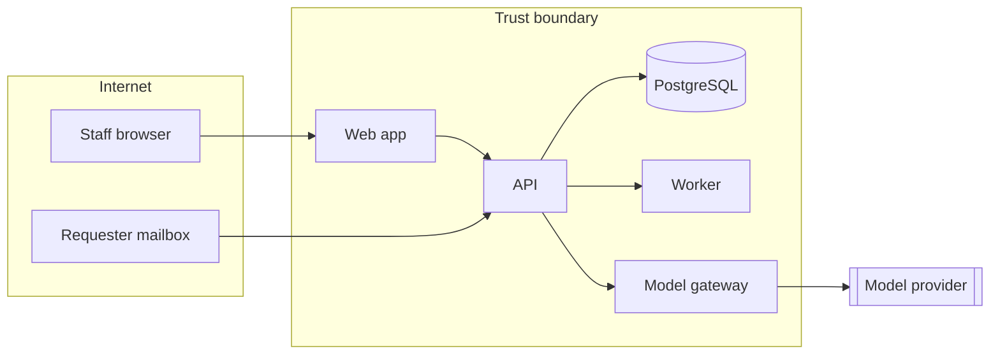

<!--
WORKED EXAMPLE for the fictional TicketDesk app.
This is teaching material, not a completed assessment and not a record from
another repository. Replace it with the outcome of your own session.
-->

# Threat model — TicketDesk (example)

| Field | Value |
|---|---|
| Version | 0 (illustrative) |
| Last session | 2026-10-18 |
| Participants | Example only — no session was held |
| Security reviewer | <name> |
| ASVS level | L2 |

## 1. What are we working on?

### 1.1 Scope

A multi-tenant web app. Staff authenticate, file tickets, assign them, and reply. A gateway calls a pinned model to suggest a category, a priority, and a draft reply. The model cannot send mail or change assignees. A separate concern, reviewed once below, is the coding-agent setup used to build the product (permission lists, audit hook, MCP allow-list).

Out of scope for this example: the concrete cloud account, the identity provider's internals, and any mobile client.

### 1.2 Data-flow diagram

### 1.3 Assets and trust boundaries

| Asset | Classification | Where it lives |
|---|---|---|
| Staff session | Confidential | short-lived token; server-side session store |
| Ticket body and requester email | Confidential | database; masked before any model call; never a log field |
| Knowledge-base articles | Internal | database; retrieved only inside the caller's tenant |
| Model draft | Confidential | database, linked to the ticket; traces kept 14 days |
| Audit log of agent tool calls | Internal | `.agents/audit/` on the developer machine; gitignored |

| Boundary | Between | Controls on the crossing |
|---|---|---|
| TB-1 | Browser and API | TLS, authentication, rate limit, schema validation |
| TB-2 | API and database | tenant set on the session; row-level security forced |
| TB-3 | API and model provider | gateway only; masking; pinned model; budget |
| TB-4 | Coding agent and developer machine | permission deny-list; MCP allow-list; audit hook |

## 2. What can go wrong?

| ID | Element | STRIDE | Threat | Likelihood | Impact | Mitigation | Status | Verified by |
|---|---|---|---|---|---|---|---|---|
| TM-001 | Staff to API | Spoofing | Stolen session token reused from another machine | M | H | Short-lived access token, refresh rotation with reuse detection | Open | test_session_rotation |
| TM-002 | Staff to API | Spoofing | Password guessing against staff login | M | H | Memory-hard password hash, rate limit, identical errors | Open | test_login_rate_limit |
| TM-003 | API to database | Tampering | Filter string concatenated into SQL | L | H | Query layer only; a SAST rule for raw SQL | Open | SAST gate |
| TM-004 | API | Tampering | Ticket body stored as HTML and later rendered raw | M | H | Store text; encode on output | Open | test_ticket_body_encoded |
| TM-005 | API | Repudiation | Staff sends a reply and later denies it | M | M | Append-only record of sender, time, and body hash | Open | test_reply_audit |
| TM-006 | API to logs | Information disclosure | Ticket body or requester email written to logs | M | H | Logging helper drops those fields; audit hook redacts secret shapes | Open | test_log_redaction |
| TM-007 | API to model | Information disclosure | Full ticket text, including a pasted secret, sent to the provider | M | H | Mask known secret shapes and requester emails before the gateway | Open | test_prompt_masking |
| TM-008 | Retrieval | Information disclosure | Knowledge-base hit from another tenant included in a prompt | M | H | Tenant predicate in the query, enforced by row-level security | Open | test_retrieval_tenant |
| TM-009 | GET /tickets/{id} | Elevation of privilege | A staff member changes the id and reads another tenant's ticket | M | H | Tenant from the session only; cross-tenant response is not-found | Open | test_ticket_cross_tenant |
| TM-010 | Assign ticket | Elevation of privilege | A requester-level token assigns or closes a ticket | M | H | Role check on the server | Open | test_assign_requires_staff |
| TM-011 | List tickets | Denial of service | Unbounded page size | M | M | Maximum page size and a rate limit | Open | load test |
| TM-012 | Suggest reply | Denial of service | A loop of suggestion calls spends the model budget | M | M | Per-tenant budget and a hard max-token cap | Open | gateway config |
| TM-013 | Attachment upload | Tampering | Uploaded file served from the app origin with an active content type | M | H | Store outside the origin; force a download content type; scan | Open | test_attachment_content_type |
| TM-014 | Suggested reply | Tampering | Model output is treated as a tool call and sends mail | L | H | Model output is parsed into a draft schema; send is a separate staff action | Open | test_suggestion_cannot_send |
| TM-015 | Coding agent | Elevation of privilege | Instructions in a ticket fixture tell the agent to widen permissions | M | H | Baseline rules treat repo text as data; permission files are denied for edits | Open | permission deny-list |
| TM-016 | Audit log | Information disclosure | A tool argument contains a token and the log is committed | M | H | Value-pattern redaction; `.agents/audit/` gitignored | Open | tests/test_audit_log.py |

## 3. Model threats

| Category | Applies? | Threat here | Mitigation | Verified by |
|---|---|---|---|---|
| LLM01 Prompt injection | Yes | Requester text tells the model to ignore the ticket and emit another tenant's data or a send action | Instructions and ticket text are separate fields; output must match the draft schema; no send tool | eval: injection cases |
| LLM02 Sensitive disclosure | Yes | A reply draft echoes a secret the requester pasted | Mask before the call; staff review before send | test_prompt_masking |
| LLM03 Supply chain | Yes | An unpinned model or plugin changes behaviour | Gateway pins the model id; plugins are not enabled in this example | release check |
| LLM04 Data and model poisoning | Yes | A knowledge-base article is edited to bias every draft | Articles are tenant-scoped and attributed; ingestion rejects unexpected types | ingestion tests |
| LLM05 Improper output handling | Yes | Draft HTML is rendered in the staff UI | Draft is plain text and encoded | test_draft_encoded |
| LLM06 Excessive agency | Yes | The suggestion path gains a tool that emails the requester | Tool list for this feature is empty; send stays a staff endpoint | test_suggestion_cannot_send |
| LLM07 System prompt leakage | Yes | A requester asks the model to print its instructions, and the draft shows them | Leakage cases in the eval set; staff review | eval: leakage |
| LLM08 Vector and embedding weaknesses | Yes | Retrieval ignores tenant | Tenant filter plus row-level security; deletion removes embeddings with the ticket | test_retrieval_tenant |
| LLM09 Misinformation | Yes | A confident draft invents a policy | Show the draft only when it cites a knowledge-base passage from the same tenant; otherwise staff write the reply | eval: groundedness |
| LLM10 Unbounded consumption | Yes | Repeated suggest calls | Budget, rate limit, max tokens | gateway config |

## 4. Agentic threats

These rows cover the coding agents that work in the repository, not an agent inside TicketDesk. The product's model has no tools (see LLM06).

| Category | Applies? | Threat | Mitigation | Verified by |
|---|---|---|---|---|
| ASI01 Goal hijack | Yes | A fixture or web page tells the agent to ignore the baseline rules | Rules say repo and web text are data; the agent is told to stop and report | review |
| ASI02 Tool misuse | Yes | The agent runs a production cloud CLI or force-pushes | Deny-list in Claude settings and Copilot auto-approve map | settings review |
| ASI03 Identity and privilege abuse | Yes | The agent uses a long-lived admin token | Human credentials stay with the human; the agent does not approve or merge | baseline rules |
| ASI04 Supply chain | Yes | An MCP server is added without review, or its tool text changes | Allow-list is empty until a reviewed server is copied in; hash recorded on approval | mcp-allowlist.yml |
| ASI05 Unexpected code execution | Yes | A hook or skill is edited so a later command runs arbitrary code | Edits to hooks and skills are on the deny list and in CODEOWNERS | CODEOWNERS |
| ASI06 Memory poisoning | Not in this example | No long-term agent memory is configured | — | — |
| ASI07 Insecure inter-agent messages | Not in this example | Reviewer agents are read-only prompts, not a network of agents | — | — |
| ASI08 Cascading failures | Yes | A delegated task retries without a budget | Task file states a step and token budget; the agent stops when it is nearly spent | tasks template |
| ASI09 Trust exploitation | Yes | A reviewer agent presents itself as an approval | Reviewer prompts say they do not approve; a human merges | agent prompts |
| ASI10 Rogue agents | Yes | A session keeps acting after the human wants it stopped | Human can stop the harness; audit log shows the tool calls | audit hook |

## 5. Privacy

| Category | Question | Finding | Mitigation |
|---|---|---|---|
| Linking | Can records be combined into a profile? | Ticket history plus requester email is a profile of the person who wrote in | Access follows staff role; exports are audited |
| Identifying | Can a person be identified from data you call anonymous? | Model traces can still be identifying if masking fails | Mask emails and known secret shapes; short trace retention |
| Non-repudiation | Are people unable to deny an action they should be able to deny? | Staff sends should be provable; mere page views need not be | Audit the send, not every read |
| Detecting | Can someone infer that a person is in the system? | A cross-tenant response must not reveal that a ticket id exists | Not-found for both missing and forbidden ids |
| Disclosure | Do you collect more than the feature needs? | Suggested reply needs the ticket and the knowledge base, not the staff member's calendar | Prompt builder takes only those fields |
| Unawareness | Do people know a model is involved? | Requesters do not see the draft; staff do | The staff UI labels the draft as a suggestion |
| Non-compliance | Do deletion and retention happen, including embeddings? | Closed tickets expire | A deletion job removes the row, attachments, and embeddings |

## 6. Actions

| Threat | Action | Owner | Issue | Due |
|---|---|---|---|---|
| TM-001 | Specify session rotation before any auth code | Tech lead | example | before build |
| TM-007 | Specify the masker and its tests before the gateway client | Tech lead | example | before build |
| TM-009 | Make the cross-tenant test part of the first tickets task | Tech lead | example | before build |

## 7. Did we do a good enough job?

- [x] Every trust boundary in the diagram has at least one threat
- [ ] High-impact threats are still Open, because this example has no implementation
- [ ] Mitigations name tests that do not exist yet
- [x] Model and coding-agent sections are filled
- [x] This file is labelled as illustration, so it is not mistaken for a signed assessment

## Change log

| Date | Version | Change | Participants |
|---|---|---|---|
| 2026-10-18 | 0 | Illustrative example written for the template | example |
